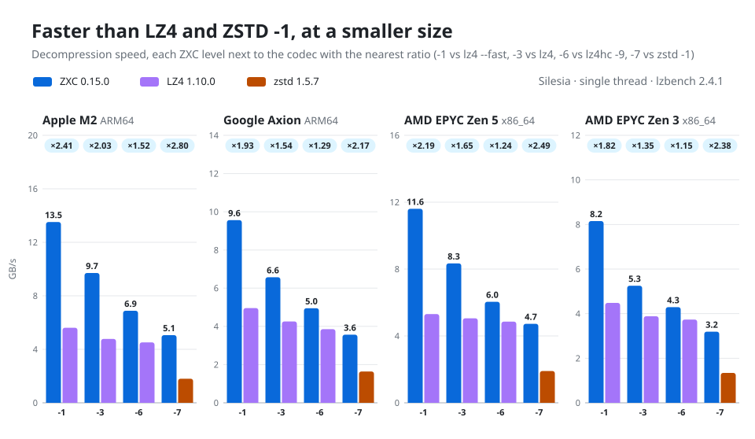
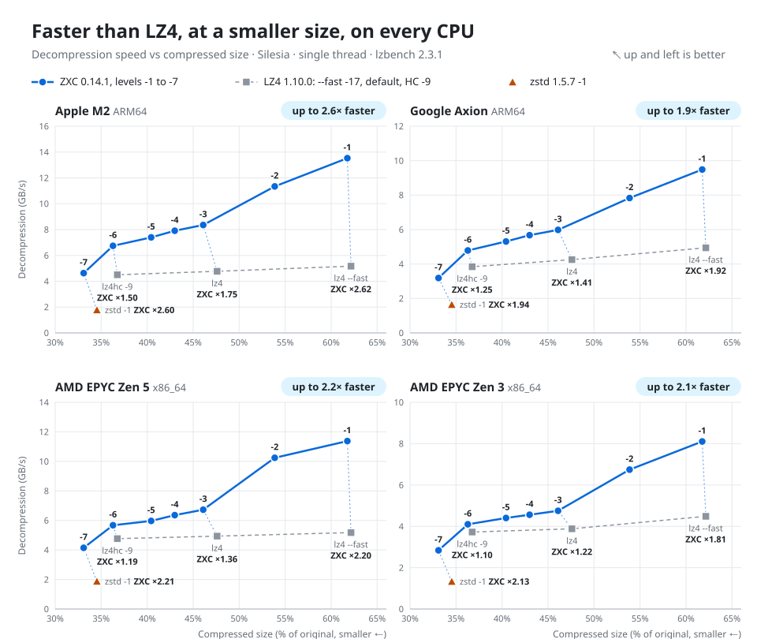
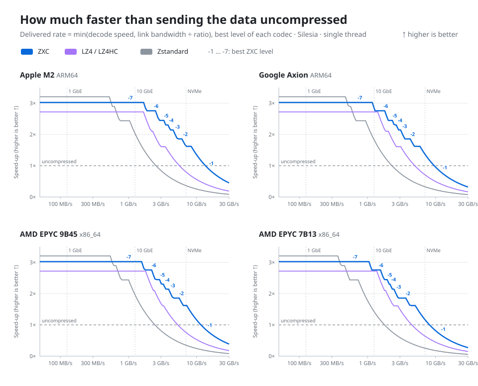

# ZXC - Lossless Compression Built for Ultra-Fast Decode

[](https://github.com/hellobertrand/zxc/actions/workflows/build.yml)
[](https://oss-fuzz-build-logs.storage.googleapis.com/index.html#zxc)
[](https://codecov.io/github/hellobertrand/zxc)
[](https://scorecard.dev/viewer/?uri=github.com/hellobertrand/zxc)
[](LICENSE)

<!-- [](https://github.com/hellobertrand/zxc/releases/latest) -->

ZXC is a fast lossless compression algorithm, targeting write-once, read-many workloads: data compressed once at build time, then decompressed on every device that reads it. It features an extremely fast decoder, with speeds of multiple GB/s per core: levels -1 to -6 decode 1.1x to 2.4x faster than LZ4 (`lz4 --fast`, `lz4` or `lz4hc`, whichever matches the ratio) at an equal or better compression ratio. Level -7, the densest, compresses better than `zstd -1` while decoding up to 2.8x faster.

ZXC also provides seekable archives for O(1) random access, in-place decompression, and dictionary compression for small data.

The ZXC format is fully specified in [FORMAT.md](docs/FORMAT.md) and guarded by public conformance vectors. This repository is the reference implementation, provided as an open-source BSD 3-Clause licensed C library and a command line utility producing and decoding `.zxc` files, with official bindings for Rust, Python, Node.js, Go and WASM. The design is described in the [whitepaper](docs/WHITEPAPER.md).

## Benchmarks

**Decompression speedup against the closest competitor at each ratio tier** — Silesia corpus (202 MB), single thread, reproducible with [lzbench](https://github.com/inikep/lzbench) and [TurboBench](https://github.com/powturbo/TurboBench):

| Machine | `-1` vs `lz4 --fast` | `-3` vs `lz4` | `-6` vs `lz4hc -9` | `-7` vs `zstd -1` |
| :--- | ---: | ---: | ---: | ---: |
| Apple M2 | **2.41x** | **2.03x** | **1.52x** | **2.80x** |
| Axion (Neoverse-V2) | **1.93x** | **1.54x** | **1.29x** | **2.17x** |
| EPYC 9B45 (Zen 5) | **2.19x** | **1.65x** | **1.24x** | **2.49x** |
| EPYC 7B13 (Zen 3) | **1.82x** | **1.35x** | **1.15x** | **2.38x** |

ZXC also compresses smaller in each pairing: 61.76 % vs 62.15 %, 46.65 % vs 47.60 %, 36.28 % vs
36.75 % and 33.09 % vs 34.53 % of the original size.

<p align="center">
  <a href="docs/images/bench-bars.svg">
    
  </a>
</p>

Measured with lzbench 2.4.1 (by [@inikep](https://github.com/inikep)), `MOREFLAGS="-march=native"`:
Apple M2 (Clang 21, macOS 26), Google Axion / Neoverse-V2 (GCC 14, GCP C4A), AMD EPYC 9B45 / Zen 5
(GCP C4D) and AMD EPYC 7B13 / Zen 3 (GCP C2D), x86 with SMT disabled. Re-run on every commit
([latest logs](https://github.com/hellobertrand/zxc/actions/workflows/benchmark.yml)). TurboBench
carries ZXC alongside 70+ other codecs. Cycles per byte and memory:
**[whitepaper](docs/WHITEPAPER.md#7-performance-analysis-benchmarks)**.

### Every level, on every CPU



### All codecs

Apple M2 (ARM64)

| Codec | Compression | Decompression | Ratio |
| :--- | ---: | ---: | ---: |
| **zxc 0.15.0 -1** | 886 MB/s | **13513 MB/s** | **61.76 %** |
| **zxc 0.15.0 -2** | 588 MB/s | **11320 MB/s** | **53.86 %** |
| **zxc 0.15.0 -3** | 267 MB/s | **9707 MB/s** | **46.65 %** |
| **zxc 0.15.0 -4** | 194 MB/s | **8790 MB/s** | **43.43 %** |
| **zxc 0.15.0 -5** | 114 MB/s | **8118 MB/s** | **40.83 %** |
| **zxc 0.15.0 -6** | 14.5 MB/s | **6884 MB/s** | **36.28 %** |
| **zxc 0.15.0 -7** | 9.71 MB/s | **5054 MB/s** | **33.09 %** |
| lz4 1.10.0 --fast -17 | 1347 MB/s | 5609 MB/s | 62.15 % |
| lz4 1.10.0 | 814 MB/s | 4774 MB/s | 47.60 % |
| lz4hc 1.10.0 -9 | 48.4 MB/s | 4522 MB/s | 36.75 % |
| lzav 5.17 -1 | 686 MB/s | 3876 MB/s | 39.91 % |
| snappy 1.3.1 | 661 MB/s | 3258 MB/s | 47.85 % |
| zstd 1.5.7 --fast --1 | 723 MB/s | 2538 MB/s | 41.01 % |
| zstd 1.5.7 -1 | 645 MB/s | 1803 MB/s | 34.53 % |
| zstd 1.5.7 -3 | 375 MB/s | 1680 MB/s | 31.20 % |
| zlib 1.3.2 -1 | 135 MB/s | 378 MB/s | 36.45 % |

<details>
<summary>Google Axion (Neoverse-V2, ARM64)</summary>

| Codec | Compression | Decompression | Ratio |
| :--- | ---: | ---: | ---: |
| **zxc 0.15.0 -1** | 885 MB/s | **9564 MB/s** | **61.76 %** |
| **zxc 0.15.0 -2** | 593 MB/s | **7895 MB/s** | **53.86 %** |
| **zxc 0.15.0 -3** | 256 MB/s | **6571 MB/s** | **46.65 %** |
| **zxc 0.15.0 -4** | 186 MB/s | **6105 MB/s** | **43.43 %** |
| **zxc 0.15.0 -5** | 109 MB/s | **5683 MB/s** | **40.83 %** |
| **zxc 0.15.0 -6** | 13.5 MB/s | **4950 MB/s** | **36.28 %** |
| **zxc 0.15.0 -7** | 8.82 MB/s | **3563 MB/s** | **33.09 %** |
| lz4 1.10.0 --fast -17 | 1278 MB/s | 4954 MB/s | 62.15 % |
| lz4 1.10.0 | 730 MB/s | 4258 MB/s | 47.60 % |
| lz4hc 1.10.0 -9 | 43.2 MB/s | 3850 MB/s | 36.75 % |
| lzav 5.17 -1 | 576 MB/s | 2949 MB/s | 39.91 % |
| snappy 1.3.1 | 566 MB/s | 2295 MB/s | 47.85 % |
| zstd 1.5.7 --fast --1 | 302 MB/s | 2291 MB/s | 41.01 % |
| zstd 1.5.7 -1 | 523 MB/s | 1642 MB/s | 34.53 % |
| zstd 1.5.7 -3 | 329 MB/s | 1525 MB/s | 31.20 % |
| zlib 1.3.2 -1 | 115 MB/s | 389 MB/s | 36.45 % |

</details>

<details>
<summary>AMD EPYC 9B45 (Zen 5, x86_64)</summary>

| Codec | Compression | Decompression | Ratio |
| :--- | ---: | ---: | ---: |
| **zxc 0.15.0 -1** | 868 MB/s | **11609 MB/s** | **61.76 %** |
| **zxc 0.15.0 -2** | 585 MB/s | **10332 MB/s** | **53.86 %** |
| **zxc 0.15.0 -3** | 253 MB/s | **8335 MB/s** | **46.65 %** |
| **zxc 0.15.0 -4** | 183 MB/s | **7508 MB/s** | **43.43 %** |
| **zxc 0.15.0 -5** | 110 MB/s | **7014 MB/s** | **40.83 %** |
| **zxc 0.15.0 -6** | 15.3 MB/s | **6045 MB/s** | **36.28 %** |
| **zxc 0.15.0 -7** | 10.2 MB/s | **4724 MB/s** | **33.09 %** |
| lz4 1.10.0 --fast -17 | 1284 MB/s | 5305 MB/s | 62.15 % |
| lz4 1.10.0 | 766 MB/s | 5052 MB/s | 47.60 % |
| lz4hc 1.10.0 -9 | 45.4 MB/s | 4861 MB/s | 36.75 % |
| lzav 5.17 -1 | 699 MB/s | 3603 MB/s | 39.91 % |
| snappy 1.3.1 | 564 MB/s | 2420 MB/s | 47.89 % |
| zstd 1.5.7 --fast --1 | 664 MB/s | 2451 MB/s | 41.01 % |
| zstd 1.5.7 -1 | 606 MB/s | 1898 MB/s | 34.53 % |
| zstd 1.5.7 -3 | 369 MB/s | 1733 MB/s | 31.20 % |
| zlib 1.3.2 -1 | 134 MB/s | 392 MB/s | 36.45 % |

</details>

<details>
<summary>AMD EPYC 7B13 (Zen 3, x86_64)</summary>

| Codec | Compression | Decompression | Ratio |
| :--- | ---: | ---: | ---: |
| **zxc 0.15.0 -1** | 724 MB/s | **8155 MB/s** | **61.76 %** |
| **zxc 0.15.0 -2** | 481 MB/s | **6807 MB/s** | **53.86 %** |
| **zxc 0.15.0 -3** | 214 MB/s | **5252 MB/s** | **46.65 %** |
| **zxc 0.15.0 -4** | 157 MB/s | **4952 MB/s** | **43.43 %** |
| **zxc 0.15.0 -5** | 93.3 MB/s | **4779 MB/s** | **40.83 %** |
| **zxc 0.15.0 -6** | 11.9 MB/s | **4290 MB/s** | **36.28 %** |
| **zxc 0.15.0 -7** | 7.97 MB/s | **3188 MB/s** | **33.09 %** |
| lz4 1.10.0 --fast -17 | 1108 MB/s | 4485 MB/s | 62.15 % |
| lz4 1.10.0 | 638 MB/s | 3883 MB/s | 47.60 % |
| lz4hc 1.10.0 -9 | 37.1 MB/s | 3731 MB/s | 36.75 % |
| lzav 5.17 -1 | 459 MB/s | 2955 MB/s | 39.91 % |
| snappy 1.3.1 | 507 MB/s | 1837 MB/s | 47.89 % |
| zstd 1.5.7 --fast --1 | 486 MB/s | 1784 MB/s | 41.01 % |
| zstd 1.5.7 -1 | 444 MB/s | 1339 MB/s | 34.53 % |
| zstd 1.5.7 -3 | 232 MB/s | 1178 MB/s | 31.20 % |
| zlib 1.3.2 -1 | 106 MB/s | 358 MB/s | 36.45 % |

</details>

### Throughput over a link



> **Reading the chart**
>
> Data compressed once is read many times over a link: disk, network, another core. With transfer and decoding overlapped, a reader gets `min(decode speed, bandwidth ÷ ratio)` of original data per second. The chart divides that by the bandwidth, so 1x is sending the data uncompressed, and draws each codec at its best level for the link. Compression time is left out, as it is paid once.
>
> - **Below 0.4–0.6 GB/s the ratio decides**, and `zstd -3` is ahead.
> - **From there on, a ZXC level delivers the most data**: -7 up to 1.1–1.7 GB/s, then the faster levels in turn. No LZ4 or LZ4HC level is ever above the ZXC curve.
> - **Compression stops paying** once one decoding thread is slower than the link: past 8.2–13.5 GB/s for `zxc -1`, 4.5–5.6 GB/s for LZ4.

## Features

- **Write once, read many.** The encoder does the heavy lifting, so every device that reads the data decodes faster: content delivery, game assets, app bundles, firmware. Gains are largest on modern CPUs ([benchmarks](#benchmarks)).
- **O(1) random access.** An optional seek table (`-S`) decompresses any block without reading the rest.
- **Decodes in place.** One buffer instead of two, zero allocations with a static context: made for firmware, FOTA and bootloaders ([details](#in-place-decompression)).
- **Small payloads too.** A trained dictionary recovers ratio on 4–128 KB blocks ([details](#dictionary-compression)).
- **Runs everywhere.** x86_64, ARM64, ARMv7, ARMv6, RISC-V, POWER, s390x, i386, with hand-tuned SIMD (AVX2/AVX-512/NEON).
- **Production-grade.** Continuously fuzzed by OSS-Fuzz, ASan/UBSan/Valgrind-clean, a [specified wire format](docs/FORMAT.md) with conformance vectors, signed releases, BSD-3-Clause.

**Used in** [ClickHouse](https://clickhouse.com/docs/reference/statements/create/table/codec) (experimental column codec) · **Packaged in** Debian 14, Ubuntu 26.10, Homebrew, vcpkg, Conan, Winget · **Benchmarked in** lzbench & TurboBench

## Compression Levels

*   **Levels 1–2 (Fast):** real-time assets: games, UI.
*   **Levels 3–4 (Balanced, 3 is the default):** a better ratio than LZ4 at efficient compression speed.
*   **Level 5 (Compact):** embedded and firmware: a better ratio than LZ4, much faster decode than Zstandard.
*   **Level 6 (Density):** a better ratio *and* faster decode than LZ4HC on every measured platform; for archival, where compression time is amortized over many reads.
*   **Level 7 (Ultra):** maximum density, past `zstd -1` while decoding more than twice as fast. Compression is the slowest tier.

## Usage

### 1. CLI

```bash
# Compress. -z is implied, and the output name defaults to <input>.zxc
zxc assets.tar                        # level 3 (default) -> assets.tar.zxc
zxc -z -5 assets.tar assets.tar.zxc   # level 5
zxc -z -S assets.tar assets.tar.zxc   # seekable: O(1) random-access decompression

# Decompress. "unzxc" (POSIX installs) is an alias for "zxc -d"
zxc -d assets.tar.zxc assets.tar
unzxc assets.tar.zxc assets.tar

# Decompress to stdout. "zxccat" (POSIX installs) runs "zxc -dcf" on each file
zxccat logs-1.zxc logs-2.zxc | grep ERROR

# Read a compressed file page by page in less (POSIX installs)
zxcless app.log.zxc

# Search compressed files with grep's options (POSIX installs)
zxcgrep -n ERROR logs-*.zxc

# Benchmark mode (testing speed on your machine)
zxc -b assets.tar
```

Every option is in `zxc --help` and the [man page](src/cli/zxc.1.md).

#### Using with `tar`

ZXC works as a drop-in external compressor for `tar` (reads stdin, writes stdout, returns 0 on success):

```bash
# GNU tar (Linux)
tar -I 'zxc -5' -cf archive.tar.zxc data/
tar -I 'zxc -d' -xf archive.tar.zxc

# bsdtar (macOS)
tar --use-compress-program='zxc -5' -cf archive.tar.zxc data/
tar --use-compress-program='zxc -d' -xf archive.tar.zxc

# Pipes (universal)
tar cf - data/ | zxc > archive.tar.zxc
zxc -d < archive.tar.zxc | tar xf -
```

### 2. API

The one-shot calls are stateless and **thread-safe**: buffers are caller-allocated with explicit
bounds, and parameters go through options structs, so call sites stay readable and
forward-compatible. Reusable contexts are per-thread: never share a `zxc_cctx` / `zxc_dctx`
between threads.

```c
#include "zxc.h"

// Compression
size_t bound = zxc_compress_bound(src_size);
zxc_compress_opts_t c_opts = {
    .level            = ZXC_LEVEL_DEFAULT,
    .checksum_enabled = 1,
    /* .block_size = 0 -> 512 KB default */
};
int64_t compressed_size = zxc_compress(src, src_size, dst, bound, &c_opts);

// Decompression
zxc_decompress_opts_t d_opts = { .checksum_enabled = 1 };
int64_t decompressed_size = zxc_decompress(src, src_size, dst, dst_capacity, &d_opts);
```

The same structs drive `zxc_stream_compress()` / `zxc_stream_decompress()` (multi-threaded file
streaming, one worker per core by default), reusable `zxc_cctx` / `zxc_dctx` contexts that skip
per-call allocation in tight loops (`zxc_cctx` compression settings are **sticky**: `NULL` reuses
the last successful call's, except dictionary options), and `.seekable = 1`, which appends a seek
table for O(1) random access.

**[👉 See complete examples and advanced usage](docs/EXAMPLES.md)** — stream API, reusable contexts,
seekable readers, dictionaries and numeric pre-filters, as full compilable programs.

## Installation

ZXC is packaged in the major ecosystems:

[](https://repology.org/project/zxc/versions)
[](https://repology.org/project/zxc/versions)
[](https://repology.org/project/zxc/versions)
[](https://repology.org/project/zxc/versions)
[](https://repology.org/project/zxc/versions)

| Ecosystem | Install |
| :--- | :--- |
| [vcpkg](https://vcpkg.io/) | `vcpkg install zxc`, or `"dependencies": ["zxc"]` in `vcpkg.json` |
| [Conan](https://conan.io/) | `conan install -r conancenter --requires="zxc/[*]" --build=missing`, or `zxc/[*]` under `[requires]` in `conanfile.txt` |
| [Homebrew](https://formulae.brew.sh/formula/zxc) | `brew install zxc` |
| winget (Windows 10 1709+) | `winget install hellobertrand.zxc` |

The vcpkg, Conan Center and winget recipes are community-maintained and can lag a release behind;
if one does, open an issue on that registry's index repository. Rust, Python, Node.js, Go and WASM
packages: [Language Bindings](#language-bindings).

### From a release archive

Prebuilt binaries for Linux and Windows (x86_64 and ARM64) and macOS (ARM64) are on the
[Releases page](https://github.com/hellobertrand/zxc/releases), with a signed checksum manifest
and build attestations: [verification steps](docs/INSTALL.md#release-archives).

### In your project

```cmake
find_package(zxc REQUIRED)          # find_package(zxc CONFIG REQUIRED) via vcpkg or Conan
target_link_libraries(myapp PRIVATE zxc::zxc_lib)
```

```bash
cc myapp.c $(pkg-config --cflags --libs libzxc) -o myapp
```

Vendoring zxc instead — CMake `FetchContent` or `add_subdirectory()`, a Meson subproject or WrapDB —
and building from source, with the full option table and the PGO workflow:
**[docs/INSTALL.md](docs/INSTALL.md)**.

## Language Bindings

[](https://crates.io/crates/zxc-compress)
[](https://pypi.org/project/zxc-compress)
[](https://www.npmjs.com/package/zxc-compress)

Official wrappers maintained in this repository:

| Language | Package Manager | Install Command | Documentation | Author |
|----------|-----------------|-----------------|---------------|--------|
| **Rust** | [`crates.io`](https://crates.io/crates/zxc-compress) | `cargo add zxc-compress` | [README](wrappers/rust/zxc/README.md) | [@hellobertrand](https://github.com/hellobertrand) |
| **Python**| [`PyPI`](https://pypi.org/project/zxc-compress) | `pip install zxc-compress` | [README](wrappers/python/README.md) | [@nuberchardzer1](https://github.com/nuberchardzer1) |
| **Node.js**| [`npm`](https://www.npmjs.com/package/zxc-compress) | `npm install zxc-compress` | [README](wrappers/nodejs/README.md) | [@hellobertrand](https://github.com/hellobertrand) |
| **Go** | `go get` | `go get github.com/hellobertrand/zxc/wrappers/go` | [README](wrappers/go/README.md) | [@hellobertrand](https://github.com/hellobertrand) |
| **WASM** | [`npm`](https://www.npmjs.com/package/zxc-wasm) | `npm install zxc-wasm` | [README](wrappers/wasm/README.md) | [@hellobertrand](https://github.com/hellobertrand) |

Community-maintained bindings:

| Language | Package Manager | Install Command | Repository | Author |
| -------- | --------------- | --------------- | ---------- | ------ |
| **Go** | pkg.go.dev | `go get github.com/meysam81/go-zxc` | <https://github.com/meysam81/go-zxc> | [@meysam81](https://github.com/meysam81) |
| **Nim** | nimble | `nimble install zxc` | <https://github.com/openpeeps/zxc-nim> | [@georgelemon](https://github.com/georgelemon) |
| **Free Pascal** | Build from source | Clone the repository | <https://github.com/Xelitan/Free-Pascal-port-of-ZXC-compressor-decompressor> | [@Xelitan](https://github.com/Xelitan) |

## In-Place Decompression

A normal decode needs two buffers, so peak memory is *compressed + decompressed*. ZXC can decode **inside a single buffer**: place the archive at its end, and the decoder writes the output from its start.

```
buffer:  [ output → → →          | archive → → → ]
           ^ write cursor           ^ read cursor
```

Both cursors move right and a ZXC block never expands, so with a small margin the write cursor provably never catches the read cursor: peak memory drops to roughly *decompressed* alone. This is the shape of firmware images, FOTA payloads, bootloaders, game assets: anything read-only that already sits in RAM.

```c
size_t need = zxc_decompress_inplace_bound(archive, archive_size);   // reads header + footer only
uint8_t* buf = malloc(need);
memcpy(buf + (need - archive_size), archive, archive_size);          // archive at the end
int64_t n = zxc_decompress_inplace(buf, need, archive_size, NULL);   // decode from buf[0]
// buf[0 .. n) now holds the decompressed data
```

The margin is about one block, so small payloads want small blocks (`-B`). An undersized buffer, or an archive whose output would reach input not yet read, is rejected with an error, never silent corruption; both entry points are fuzzed. For kernel code and heapless targets, `zxc_decompress_inplace_dctx` with a static context touches no allocator at all. Margin and context sizes per block size, and the static-context API: [API.md](docs/API.md#zxc_decompress_inplace_bound).

## Dictionary Compression

For data compressed in **small blocks** (4 KB–128 KB), a pre-trained dictionary substantially
improves the ratio. It prefills the LZ77 window at the *start of each block*, so the smaller the
block, the more it gains: a single small payload, or a large corpus split into small blocks for
random access. A `.zxd` also carries a shared literal Huffman table (levels 6–7), which spares small
blocks their own 128-byte table header.

**Typical use cases:** JSON API responses, small game assets, structured logs, key-value store
records, RPC messages, seekable archives with small blocks.

```bash
# Train from a corpus of similar files. Without -o: ./dictionary_<dict_id>.zxd
zxc --train samples/*.json
zxc --train -o corpus.zxd samples/*.json     # -o also accepts a directory

# The same dictionary is required to decompress: pass it with -D, there is no auto-lookup
zxc -z -D corpus.zxd input.json
zxc -d -D corpus.zxd input.json.zxc
```

The archive records only the dictionary's `dict_id`: decompressing without it returns
`ZXC_ERROR_DICT_REQUIRED`, with the wrong one `ZXC_ERROR_DICT_MISMATCH`. From C:
[EXAMPLES.md](docs/EXAMPLES.md#using-a-pre-trained-dictionary) and
[API.md §11b](docs/API.md#11b-dictionary-api). Wire format:
[FORMAT.md §12](docs/FORMAT.md#12-pre-trained-dictionary-support).

## Block Size Tuning

Blocks are powers of two from 4 KB to 2 MB. The default, **512 KB**, favours ratio and decode speed: each block starts with a cold match history, so larger blocks mean fewer cold starts. For **streaming, embedded or memory-constrained** use, **256 KB** blocks halve the decompression context and cut the compression context by ~40 %, at a small cost in ratio and decode speed.

| Block Size | cctx memory | dctx memory | Ratio (level -3) | Decompression gain vs 256 KB |
|:----------:|:-----------:|:-----------:|:----------------:|:----------------------------:|
| 256 KB | ~1.04 MB | ~514 KB | 47.21% | — |
| 512 KB *(default)* | ~1.79 MB | ~1.0 MB | 46.65% *(−0.56 pp)* | +1% to +8% depending on CPU |

```bash
# CLI — fall back to 256 KB blocks (e.g. embedded / streaming)
zxc -B 256K -5 input_file output_file

# API
zxc_compress_opts_t opts = {
    .level      = ZXC_LEVEL_COMPACT,
    .block_size = 256 * 1024,
};
```

## Format & Conformance

The wire format is fully specified in [`docs/FORMAT.md`](docs/FORMAT.md) (format version 9), so any third party can build an independent, interoperable decoder. Each format break is clean: v9 tools reject v8 archives, and [`docs/MIGRATION.md`](docs/MIGRATION.md) lists what changed and how to convert.

Two byte-frozen suites guard the format:

* **Decoder conformance** — [`tests/conformance/`](tests/conformance/README.md) ships public vectors per format version: `valid/*.zxc` streams with their expected output, and `invalid/*.zxc` streams a correct decoder **must** reject, at least one per row of the format's error table. Point your own decoder at them; locally, run the `conformance` CTest.
* **Encoder stability** — [`tests/format/`](tests/format/README.md) pins the exact bytes the encoder emits for every block type and integrity field; [`vector-stability.yml`](.github/workflows/vector-stability.yml) fails CI on any single-byte drift.

## Safety & Quality
* **Continuous fuzzing**: Google [OSS-Fuzz](https://github.com/google/oss-fuzz) runs eight harnesses (roundtrip, decompress, block, in-place, push streaming, multi-threaded FILE* streaming, seekable, dictionary) around the clock, covering over 80 % of the library's lines ([coverage history](https://introspector.oss-fuzz.com/project-profile?project=zxc)). The same harnesses run under ClusterFuzzLite (ASan + UBSan) on every pull request touching the library.
* **Dynamic analysis**: the CTest suite runs under ASan, UBSan and Valgrind in CI, with coverage tracked on Codecov.
* **Static analysis**: Cppcheck, Clang Static Analyzer, CodeQL and Snyk.
* **Safe API**: every operation takes an explicit buffer capacity.

## License & Credits

**ZXC** Copyright © Bertrand Lebonnois and contributors.
Licensed under the **BSD 3-Clause License**. See LICENSE for details.

**Third-Party Components:**
- **[rapidhash](https://github.com/Nicoshev/rapidhash)** by [Nicolas De Carli](https://github.com/Nicoshev) (MIT) - Used for high-speed, platform-independent checksums.

**Acknowledgements:**
- **[PivCo-Huffman](https://github.com/MarcinZukowski/pivco-huffman)** (PIVoted COding) by [Marcin Żukowski](https://github.com/MarcinZukowski) - the level-ordered layout and merge-based decode of ZXC's Huffman sections follow its design; implemented independently here. Special thanks to [Dougall Johnson](https://github.com/dougallj), whose idea of jointly nudging flat and length codes is behind the level 6 / 7 decode speedups.
