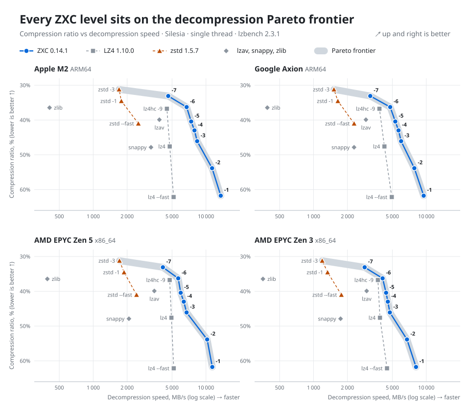
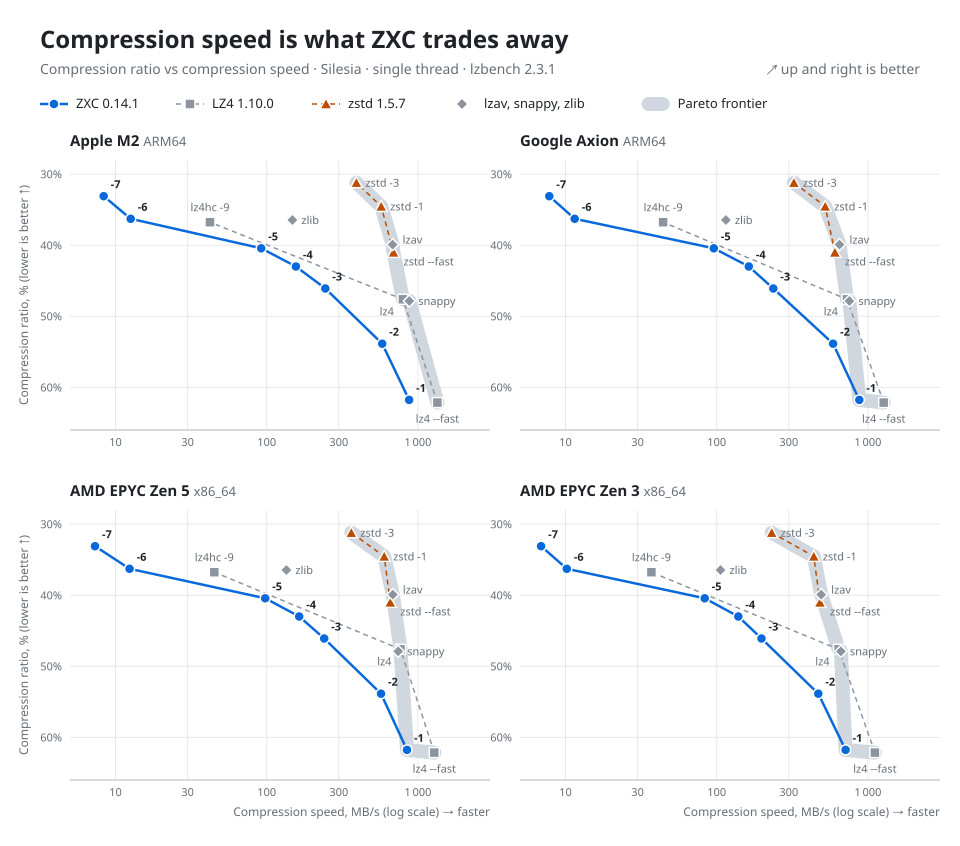
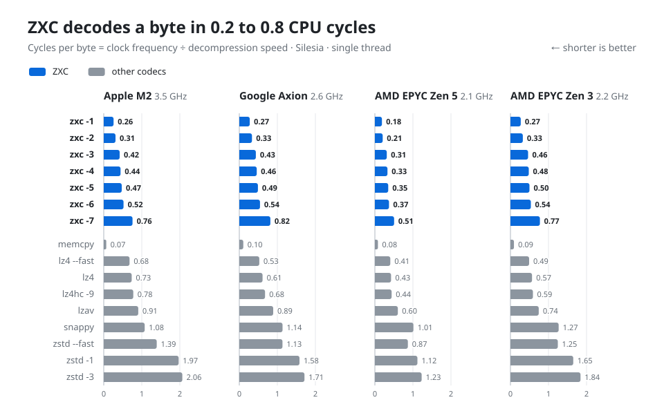

# ZXC: High-Performance Asymmetric Lossless Compression

**Version**: 0.15.0
**Date**: October 2026
**Author**: Bertrand Lebonnois

---

## 1. Executive Summary

Software delivery pipelines such as mobile gaming, embedded systems and firmware over-the-air updates produce data once, on x86 build servers, and consume it millions of times on energy-constrained ARM devices.

LZ4 and its peers are symmetric: they spend as little on compression as on decompression, which wastes the one-time encoding budget. ZXC is an asymmetric lossless codec: a slow encoder shapes the stream so that the decoder runs as fast as the hardware allows. At its default level it decodes 1.5x to 2.0x faster than LZ4 on ARM and 1.35x to 1.65x on x86, with smaller output (46.65 % against 47.60 % on Silesia).

## 2. The Efficiency Gap

Symmetric speed suits real-time logs or RAM swapping. For asset distribution it is wasted twice: the cycles saved on the build server benefit nobody, and every slow decode on a phone keeps the CPU awake longer, costing battery and heat.

## 3. Design

ZXC moves the work to the encoder. Heavy analysis at build time produces a layout that suits the instruction pipelining and branch prediction of modern CPUs, ARMv8 first.

*   **Independent blocks**: each block is encoded on its own by the codec its compression level selects: levels 1 and 2 emit PAK, higher levels SPL, with a RAW fallback when coding would not shrink the data. Blocks compress and decompress in parallel, and the seek table addresses any of them in O(1).
*   **Pipelined I/O**: a producer-consumer architecture overlaps reading, coding and writing (§6).

> **ZXC is a pure LZ byte codec**: LZ77 matching plus entropy coding, with no type-aware or numeric block. Numeric and columnar data (timestamps, IDs, float columns) compress best behind a reversible pre-filter such as delta or byte-shuffle, applied before compression and inverted after. ZXC keeps such transforms out of the format on purpose: the caller knows the element type and owns the filter. See *Compressing Numeric Data* in [`EXAMPLES.md`](EXAMPLES.md).

## 4. Core Algorithms

### 4.1 LZ77 Engine
A hash table with chaining finds matches in a 64 KB window (16-bit offsets), whatever the block size. Levels 3 to 5 match lazily: a match is deferred when a better one starts at the next byte. Levels 6 and 7 replace lazy matching with a price-based optimal parser (§5.4).

### 4.2 SIMD and Hardware Hashing
*   **ARM NEON**: `vld1q_u8` loads and `vceqq_u8` compares scan input at wire speed; `vminvq_u8` rejects non-matches early.
*   **x86**: dedicated AVX2 and AVX-512 paths over a portable SSE2 baseline, the x86-64 architectural guarantee. The SSE2 tier emulates the few SSE4.1 operations it needs (unsigned 32-bit max, byte blend, saturating `u32`→`u16` pack), so no SSE4.x hardware is required.
*   **Integrity**: block validation uses rapidhash, a non-cryptographic hash fast enough not to bottleneck decoding.

### 4.3 Entropy Coding
*   **RLE** for runs of identical literal bytes.
*   **Prefix Varint** for length overflows (below).
*   **Canonical Huffman**, length-limited to 8 bits at level 6 and 11 at level 7, over the literal distribution and, at level 7, over the sequence tokens. The code is classical; only the wire layout is new: PivCo transposes the code bits by tree level so the decoder runs data-parallel merges instead of a serial bit chain.

#### Huffman decoding with the PivCo level-ordered layout

Entropy decoding is the hot path of the high-compression levels, and classical
Huffman decoding is a serial bit chain: a codeword's length must be known
before the next one's position is. Interleaving N streams caps the parallelism
at N and keeps a load-shift-mask chain per symbol. Format v7 replaced the
layout with **PivCo-Huffman** (PIVoted COding, level-ordered Huffman). The
layout and its merge-based decode are from
[Żukowski 2026](https://marcinzukowski.github.io/pivco-huffman/paper-1.0/ph.html);
the implementation here is independent.

*   **Same code, transposed layout**: the canonical code, the 128-byte
    code-length header and the compressed size (to within per-node byte
    padding) are those of classic Huffman. Only the bit order changes: for
    every internal node of the tree, in BFS order, the section stores one
    branch bit per symbol routed through that node.
*   **Decoding is a list merge**: each tree level is rebuilt bottom-up, a
    node's bitmap saying how to interleave its two children's symbol lists.
    The merge is a byte shuffle (`TBL` on NEON, `pshufb` on SSSE3/AVX2,
    `vpexpandb` on AVX-512-VBMI2), with no gather and no per-symbol
    dependency, so throughput scales with SIMD width.
*   **Flat subtrees**: perfect subtrees whose leaves sit at the same relative
    depth `D ≥ 2` store packed `D`-bit residual codes instead of bitmaps
    (FORMAT.md § 5.2.1) and decode by direct table unpacking. Dense regions
    are the common case for the 8-bit-capped level-6 tables.
*   **Leaf pairs** decode by an XOR/blend on the bitmap
    (`out = sym0 ^ (delta & bitmask)`) without index lists.
*   **No sub-stream sizes**: the popcount of a node's bitmap is its right
    child's element count, so sizes are derived, which also removed the v6
    u16 limit.

On the post-LZ literal sections of silesia.tar at level 7 it decodes 77 %
faster than the tuned 4-stream classic decoder it replaced, at byte-identical
ratio. The scalar fallback is about 4x slower than the SIMD kernels; embedded
targets usually stay on levels 1 to 5, which carry no entropy sections.

**Selection.** Section encodings are chosen by pricing every candidate (RAW,
RLE, Huffman, shared-table Huffman) with
`J = compressed_size + premium(level) × decoded_bytes` and keeping the
minimum: a Lagrangian trade of bytes against decode time. Below ULTRA the
premium reproduces the historical margin of about 3 %; at level 7 it drops to
about 1.6 % for entropy and 0.4 % for RLE, so the encoder buys ratio with
decode cycles, which is the level-7 contract.

**Joint nudge (levels 6 and 7).** Before pricing, a DP pass relaxes the fitted
code lengths toward flatter trees whenever the modeled PivCo decode saving
outweighs the size cost, with the same premium. The result stays a canonical,
Kraft-exact code. Idea by Dougall Johnson (pivco-huffman issue #20).

#### Prefix Varint

Overflow values use a prefix varint: the number of leading `1` bits in the
first byte gives the total length, so the decoder knows the width before
reading further, with no continuation bit per byte and no serial dependency
as in VByte. An N-byte varint carries `7N` payload bits.

| Prefix (Binary) | Total Bytes | Data Bits (1st Byte) | Total Data Bits | Range (Value < X) |
|-----------------|-------------|----------------------|-----------------|-------------------|
| `0xxxxxxx`      | 1           | 7                    | 7               | 128               |
| `10xxxxxx`      | 2           | 6                    | 14 (6+8)        | 16,384            |
| `110xxxxx`      | 3           | 5                    | 21 (5+8+8)      | 2,097,152 (2 MiB) |

A varint encodes `LL - MASK` or `ML - MASK`, both bounded by
`ZXC_BLOCK_SIZE_MAX = 2 MiB`, so every legitimate varint fits in 3 bytes. A
first byte of `0xE0` or more is out of spec: encoders never emit it and
decoders reject it, which caps the varint surface at the block size limit and
removes integer overflow from downstream bounds arithmetic. Longer prefixes
are reserved for a format version that raises the limit.

**Example**: Encoding value `300` (binary: `100101100`):
```text
Value 300 > 127 and < 16383 -> Uses 2-byte format (Prefix '10').

Step 1: Low 6 bits
300 & 0x3F = 44 (0x2C, binary 101100)
Byte 1 = Prefix '10' | 101100 = 10101100 (0xAC)

Step 2: Remaining high bits
300 >> 6 = 4 (0x04, binary 00000100)
Byte 2 = 0x04

Result: 0xAC 0x04

Decoding Verification:
Byte 1 (0xAC) & 0x3F = 44
Byte 2 (0x04) << 6   = 256
Total = 256 + 44 = 300
```

## 5. Format Design

[FORMAT.md](FORMAT.md) specifies every byte of the wire format, with worked
hexdumps and public conformance vectors. This section explains the choices
behind it and the encoder and decoder pipelines, which the specification
leaves open.

### 5.1 Two Block Layouts

A data block is RAW (stored), SPL or PAK (FORMAT.md § 5). Levels 1 and 2 emit
PAK, levels 3 to 7 emit SPL, and either falls back to RAW when the coded form
would not shrink the data.

**Key Differences: SPL vs PAK**

| Feature            | SPL (Split streams)             | PAK (Packed sequences)           |
|--------------------|---------------------------------|----------------------------------|
| **Sections**       | 4 (Lit, Tokens, Offsets, Extras)| 3 (Lit, Sequences, Extras)       |
| **Sequence Format**| 1-byte token + separate offset  | Packed 32-bit word               |
| **LL/ML Bits**     | 4 bits each (overflow at 15)    | 8 bits each (overflow at 255)    |
| **Memory Access**  | Multiple stream pointers        | Single aligned 4-byte reads      |
| **Decoder Speed**  | Fast                            | Fastest (optimized for ARM/x86)  |
| **RLE Support**    | Yes (literals)                  | No                               |
| **Huffman Literals** | Yes (level ≥ 6, ≥ 139 lits)   | No                               |
| **Parser**         | Lazy (≤ L5), Optimal DP (L6-L7) | Lazy                             |
| **Best For**       | General data, good compression  | Maximum decode throughput        |

> **Why a packed word**: one aligned read per sequence removes the pointer
> chasing between token and offset streams, uses the cache better and lets the
> decoder unroll 4x.

### 5.2 Descriptor Economy

An SPL block writes a section size only when its header cannot already imply
it (FORMAT.md § 5.2); a PAK block writes none at all (FORMAT.md § 5.3). `N Literals`
and `N Sequences` are on the wire anyway, so RAW literal and token sections
need no descriptor, and the offset stream never does, its width being a header
field. That leaves the two entropy-coded sizes and the extras, recoverable as
the residue because they come last. The saving is 24 to 32 bytes per block
against the earlier fixed table, about 2 % of a 4 KB block.

> **Design Note**: a new encoding costs a new `enc_*` value and, if its size
> becomes unimplied, one more `u32` descriptor gated on that value, plus a
> format version bump. The bump is the intended mechanism, not a pool of
> reserved bytes.

### 5.3 Footer

A mandatory footer closes each frame (FORMAT.md § 8): an 8-byte archive digest
when checksums are on, then the source size and the compressed frame size on
the fewest bytes that hold them, and a last byte giving their two lengths.

The sizes cost what they hold: 5 bytes for a small frame, 9 for a few hundred
MB, against a fixed 16. A sequential decoder knows both values when it reaches
the footer, derives the one valid encoding and compares it byte for byte. Read
from the last byte, the compressed size locates the frame's header without any
other field, which is what lets frames be concatenated (FORMAT.md § 2.1).

The digest is an ordered fold of every block's checksum: a whole-archive
identity that a full decode verifies and `zxc -t` reports, and that a seekable
range read, which never sees every block, does not check. Per-block integrity
does not depend on it: each checksum is seeded with the block's position
(§5.5), so a block out of place fails on its own. The digest adds what that
cannot see, a block replaced by a valid one at the same position.

### 5.4 Block Codecs

#### SPL (levels 3 to 7)

Encoding:
1.  **Parse**: hash-chain LZ77 over a 64 KB window. Levels 3 to 5 match lazily. Levels 6 and 7 run a forward dynamic program: `dp[p]` holds the cheapest encoding of `src[0..p)`, each step emits a literal or any sub-length of the longest match at `p`, with static prices (literal ≈ 9 bits, match ≈ 24 bits plus varint extras), and backtracking from `dp[N]` yields the optimal sequence. A long-match guard skips re-search inside a match, keeping the parse O(N) on repetitive data.
2.  **Streams**: each sequence splits into a literal run, a token `(LitLen << 4) | MatchLen`, an offset and, for lengths of 15 or more, a prefix varint in the extras. Offsets take 1 byte when none exceeds 255 (`enc_off = 1`), 2 bytes otherwise.
3.  **Literal coding**: RLE and, from level 6 with at least 139 literals, a length-limited Huffman code (`L = 8` at level 6, `L = 11` at level 7) nudged toward a flat tree and written in the PivCo layout (§4.3). Level 7 codes the tokens the same way (`enc_tok = 2`). With a dictionary carrying a shared literal table (§5.7), a fourth candidate reuses the dictionary's code lengths without the 128-byte header (`enc_lit = 3`); a block holding a literal the table does not cover falls back to its own table. The Lagrangian of §4.3 keeps the cheapest candidate, so no choice is a regression.
4.  **Serialization**: sections are concatenated behind a descriptor for each coded one (§5.2), with zero padding when fewer than 32 bytes follow the literal section.

Decoding:
1.  **Sections**: sizes come from the header, descriptors are read for the coded sections only, the extras take the residue. A block with fewer than 32 bytes behind its literals is rejected.
2.  **Literals**: RAW is a view into the source; RLE expands in one pass; PivCo decodes by the SIMD merges of §4.3, with the shared-table variant using code lengths validated once, when the dictionary was attached.
3.  **Tokens** (level 7): a Huffman-coded token stream is decoded into scratch by a dedicated specialization of the block decoder, so the RAW-token path keeps its exact code shape.
4.  **Main loop**: reads the three streams together and copies with 16-byte literal loads and 32-byte match stores, overlapping matches going through dedicated overlapped-copy primitives. A safe zone at the end of the buffer switches to a bounds-checked loop, so the main loop runs without bounds checks.

#### PAK (levels 1 and 2)

Encoding: the same parser with lazy matching and step skipping, then one 32-bit word per sequence (literal length, match length minus 5, 16-bit offset), raw literals, and a varint in the extras for lengths of 255 or more. No descriptor is written: every size follows from the header (FORMAT.md § 5.3).

Decoding: one aligned read per sequence. With enough output margin the loop handles 4 sequences per iteration, pre-read into registers and copied with 32-byte SIMD stores. Offsets are validated only until the output, plus any dictionary prefix, exceeds 65536 bytes: past that point no 16-bit offset can reach below the buffer. Overlapping matches (offset below 32) take the same special path as SPL.

### 5.5 Data Integrity

Each block may carry a 32-bit checksum of its **decompressed** bytes. The question answered is "are the bytes handed back the ones that went in", not "is the payload intact".

*   **Whole pipeline**: an encoder or decoder defect, a divergence between SIMD variants, a miscompilation or a wrong dictionary accepted through a `dict_id` collision all leave the payload intact and the output wrong. Only a checksum over the output sees them.
*   **Per block**: the checksum stays usable under random access, since reading one block through the seek table verifies it. It is seeded with the block's position in the frame, so a block moved elsewhere fails too. A single whole-file hash cannot be checked without decoding everything.
*   **Cost**: verification is opt-in. Hashing the output instead of the payload costs in proportion to how well the data compresses, nothing on incompressible data. On a mixed corpus at 43.5 %, decoding goes from 23.1 to 18.7 GB/s. zstd's closest equivalent, an XXH64 of the whole frame, is off by default in libzstd and cannot vouch for a partial read.
*   **Trade-off**: a corrupted block is no longer rejected before decoding and reports whatever the decoder tripped on first. The decoder is fuzzed to stay safe on malformed input, and a checksum is forgeable, so this was never a security boundary.

The algorithm field selects the hash; only rapidhash (`0`) is defined, its 64-bit result folded to 32 bits. rapidhash is based on wyhash and was developed by Nicolas De Carli.

### 5.6 Seekable Archives

An optional seek table (a `SEK` block before the footer, FORMAT.md § 5.5) gives O(1) random access. It holds groups of 64 blocks, a `u64` anchor and one `u32` size per block, about 4.1 bytes per block. A block is found by one division (`block_index = offset / block_size`), then one bounded read from its group's anchor, with nothing of the table kept in memory. Groups are bounds-checked when loaded and each block header must agree with its entry, so a damaged entry costs only its group. The table is not authenticated: only the position-seeded block checksums bind a block to its index.

### 5.7 Pre-Trained Dictionaries

Blocks are encoded independently, so a small block (4 KB to 128 KB) has little match history of its own. A pre-trained dictionary supplies it.

*   **Mechanism**: the dictionary (up to 64 KB, the LZ window) is logically prepended to every block: at compression it seeds the hash tables, at decompression it sits before the output so match copies into it resolve by pointer arithmetic. Random access is preserved: load the dictionary once, decode any block.
*   **External and content-addressed**: dictionaries are `.zxd` files referenced from the file header by a 32-bit `dict_id`, trained once and reused across many archives. The id names the dictionary and detects a wrong one: a decoder rejects a missing dictionary (`ZXC_ERROR_DICT_REQUIRED`) or a mismatched id (`ZXC_ERROR_DICT_MISMATCH`), and the block checksums of §5.5 catch what a collision lets through.
*   **Shared literal table**: a dictionary also carries a canonical Huffman table for literals, 128 bytes of code lengths trained on the corpus's post-LZ literal distribution. Blocks that compress better with it use `enc_lit = 3` and skip the per-block header, which never amortizes on small blocks. The lengths are validated once, when the dictionary is attached. Ratio and decode speed both improve on homogeneous corpora at small block sizes, tapering to neutral as blocks grow.
*   **Binding**: a raw in-memory dictionary (library API, no table) gives `dict_id = checksum(content)` and never produces `enc_lit = 3`; a `.zxd` gives `dict_id = checksum(LE32(checksum(content)) || table)`. There is no flag on the wire: the decoder computes the id for what it was given and compares.
*   **File format**: FORMAT.md § 12.4. The `.zxd` extension is cosmetic; files are identified by their magic word.
*   **Training**: `zxc_dict_train_content()` selects the sample segments with the highest LZ77 match coverage and places the most matched ones at the end, where offsets are shortest. `zxc_dict_train_huf()` then compresses the samples with that dictionary to histogram the real post-LZ literals and derives the table. Past an 8 MiB budget, 4 KB slices are strided across the corpus; a 256-symbol histogram converges long before, so large corpora train in under a second. Unseen symbols get no code: with `L = 8`, covering all 256 would force the uniform 8-bit code, and the per-block fallback handles them.
*   **Naming**: training to a directory writes `dictionary_<dict_id>.zxd`, the id in lowercase hex. The dictionary is passed with `-D` to decompress. The name is a tooling convention and never reaches the wire.

## 6. System Architecture (Threading)

A producer-consumer pipeline keeps every core busy.

**Compression**: the main thread slices the input into fixed-size chunks (a power of 2 from 4 KB to 2 MB, 512 KB by default) and submits them to a lock-free ring buffer. Workers compress chunks independently, each in its own `zxc_cctx_t`, into thread-local buffers. A writer thread restores the original order on output.

**Decompression**: the main thread scans block headers for boundaries and sizes. On a regular file, workers read their own payloads with positioned reads and small blocks travel in batches; on a pipe, stdio feeds one block per job. Workers decode into pre-allocated buffers, using wild copies (16- and 32-byte SIMD stores) whenever the output margin allows, and blocks are committed in order.

## 7. Performance Analysis (Benchmarks)

**Methodology.** lzbench 2.4.1 (by inikep) built with `MOREFLAGS="-march=native"`, 512 KB blocks, checksums off, one thread, on [silesia.tar](https://github.com/DataCompression/corpus-collection/tree/main/Silesia-Corpus) (202 MB). The three Google Cloud instances run one thread per core (SMT disabled on the x86 C4D and C2D instances).
* **Client:** Apple M2, macOS 26, Clang 21
* **Cloud:** Google Axion (Neoverse-V2), Google Cloud C4A, Linux, GCC 14
* **Build:** AMD EPYC 9B45 (Zen 5, 2.1 GHz, SMT off), Google Cloud C4D, Linux, GCC 14
* **Production:** AMD EPYC 7B13 (Zen 3, 2.2 GHz, SMT off), Google Cloud C2D, Linux, GCC 14

Cycles per byte are `frequency / decompression speed`, at the base frequency (the performance-core frequency for the M2); lower is better. Throughput over a link is the speed-up over sending the data uncompressed, `min(Decode, Bandwidth × 100 / Ratio) / Bandwidth`, with each codec family at its best level for that bandwidth (Figure D), one decoding thread, transfer and decoding overlapped, and compression time left out as it is paid once; higher is better.

**Figure A**: Pareto Frontier — Compression Ratio vs. Decompression Speed (across 4 CPUs)



**Figure A'**: Compression Ratio vs. Compression Speed (across 4 CPUs)




### 7.1 Client ARM64 Summary (Apple Silicon M2)

| Compressor | Decompression Speed (Ratio vs LZ4) | Compressed Size (Index LZ4=100) (Lower is Better) |
| :--- | :--- | :--- |
| **zxc 0.15.0 -1** | **2.83x** | **129.75** |
| **zxc 0.15.0 -2** | **2.37x** | **113.16** |
| **zxc 0.15.0 -3** | **2.03x** | **98.01** |
| **zxc 0.15.0 -4** | **1.84x** | **91.25** |
| **zxc 0.15.0 -5** | **1.70x** | **85.79** |
| **zxc 0.15.0 -6** | **1.44x** | **76.23** |
| **zxc 0.15.0 -7** | **1.06x** | **69.52** |
| lz4 1.10.0 --fast -17 | 1.17x | 130.58 |
| lz4 1.10.0 (Ref) | 1.00x | 100.00 |
| lz4hc 1.10.0 -9 | 0.95x | 77.20 |
| lzav 5.17 -1 | 0.81x | 83.84 |
| snappy 1.3.1 | 0.68x | 100.53 |
| zstd 1.5.7 --fast --1 | 0.53x | 86.16 |
| zstd 1.5.7 -1 | 0.38x | 72.55 |
| zstd 1.5.7 -3 | 0.35x | 65.56 |
| zlib 1.3.2 -1 | 0.08x | 76.58 |

**Decompression Efficiency (Cycles per Byte @ 3.5 GHz)**

| Compressor              | Cycles/Byte | Performance vs memcpy (*) |
| ----------------------- | ----------- | --------------------- |
| memcpy                  | 0.066       | 1.00x (baseline)      |
| **zxc 0.15.0 -1**       | **0.259**   | **3.9x**              |
| **zxc 0.15.0 -2**       | **0.309**   | **4.7x**              |
| **zxc 0.15.0 -3**       | **0.361**   | **5.4x**              |
| **zxc 0.15.0 -4**       | **0.398**   | **6.0x**              |
| **zxc 0.15.0 -5**       | **0.431**   | **6.5x**              |
| **zxc 0.15.0 -6**       | **0.508**   | **7.7x**              |
| **zxc 0.15.0 -7**       | **0.693**   | **10.4x**             |
| lz4 1.10.0              | 0.733       | 11.1x                 |
| lz4 1.10.0 --fast -17   | 0.624       | 9.4x                  |
| lz4hc 1.10.0 -9         | 0.774       | 11.7x                 |
| lzav 5.17 -1            | 0.903       | 13.6x                 |
| zstd 1.5.7 -1           | 1.941       | 29.3x                 |
| zstd 1.5.7 --fast --1   | 1.379       | 20.8x                 |
| zstd 1.5.7 -3           | 2.083       | 31.4x                 |
| snappy 1.3.1            | 1.074       | 16.2x                 |
| zlib 1.3.2 -1           | 9.259       | 140x                  |

**Throughput over a link**

| Link bandwidth | ZXC | LZ4 / LZ4HC | Zstandard |
| :--- | ---: | ---: | ---: |
| 125 MB/s (1 GbE) | 3.02x (`zxc -7`) | 2.72x (`lz4hc -9`) | **3.21x** (`zstd -3`) |
| 1.25 GB/s (10 GbE) | **3.02x** (`zxc -7`) | 2.72x (`lz4hc -9`) | 2.03x (`zstd --fast --1`) |
| 3 GB/s | **2.45x** (`zxc -5`) | 1.61x (`lz4 --fast -17`) | 0.85x (`zstd --fast --1`) |
| 7 GB/s (NVMe) | **1.62x** (`zxc -1`) | 0.80x (`lz4 --fast -17`) | 0.36x (`zstd --fast --1`) |

*Reading: on Apple M2, the ratio of `zstd -3` leads below 556 MB/s. Above that a ZXC level delivers the most data: -7 up to 1.67 GB/s, then the faster levels in turn, up to 13.5 GB/s, where one decoding thread falls behind the link and compression stops paying (5.61 GB/s for LZ4). No LZ4 or LZ4HC level is ahead of the best ZXC level at any bandwidth.*


### 7.2 Cloud Server Summary (ARM64 / Google Axion Neoverse-V2)

| Compressor | Decompression Speed (Ratio vs LZ4) | Compressed Size (Index LZ4=100) (Lower is Better) |
| :--- | :--- | :--- |
| **zxc 0.15.0 -1** | **2.25x** | **129.75** |
| **zxc 0.15.0 -2** | **1.85x** | **113.16** |
| **zxc 0.15.0 -3** | **1.54x** | **98.01** |
| **zxc 0.15.0 -4** | **1.43x** | **91.25** |
| **zxc 0.15.0 -5** | **1.33x** | **85.79** |
| **zxc 0.15.0 -6** | **1.16x** | **76.23** |
| **zxc 0.15.0 -7** | **0.84x** | **69.52** |
| lz4 1.10.0 --fast -17 | 1.16x | 130.58 |
| lz4 1.10.0 (Ref) | 1.00x | 100.00 |
| lz4hc 1.10.0 -9 | 0.90x | 77.20 |
| lzav 5.17 -1 | 0.69x | 83.84 |
| snappy 1.3.1 | 0.54x | 100.53 |
| zstd 1.5.7 --fast --1 | 0.54x | 86.16 |
| zstd 1.5.7 -1 | 0.39x | 72.55 |
| zstd 1.5.7 -3 | 0.36x | 65.56 |
| zlib 1.3.2 -1 | 0.09x | 76.58 |

**Decompression Efficiency (Cycles per Byte @ 2.6 GHz)**

| Compressor              | Cycles/Byte | Performance vs memcpy (*) |
| ----------------------- | ----------- | --------------------- |
| memcpy                  | 0.101       | 1.00x (baseline)      |
| **zxc 0.15.0 -1**       | **0.272**   | **2.7x**              |
| **zxc 0.15.0 -2**       | **0.329**   | **3.3x**              |
| **zxc 0.15.0 -3**       | **0.396**   | **3.9x**              |
| **zxc 0.15.0 -4**       | **0.426**   | **4.2x**              |
| **zxc 0.15.0 -5**       | **0.458**   | **4.5x**              |
| **zxc 0.15.0 -6**       | **0.525**   | **5.2x**              |
| **zxc 0.15.0 -7**       | **0.730**   | **7.2x**              |
| lz4 1.10.0              | 0.611       | 6.0x                  |
| lz4 1.10.0 --fast -17   | 0.525       | 5.2x                  |
| lz4hc 1.10.0 -9         | 0.675       | 6.7x                  |
| lzav 5.17 -1            | 0.882       | 8.7x                  |
| zstd 1.5.7 -1           | 1.583       | 15.6x                 |
| zstd 1.5.7 --fast --1   | 1.135       | 11.2x                 |
| zstd 1.5.7 -3           | 1.705       | 16.8x                 |
| snappy 1.3.1            | 1.133       | 11.2x                 |
| zlib 1.3.2 -1           | 6.684       | 66.0x                 |

**Throughput over a link**

| Link bandwidth | ZXC | LZ4 / LZ4HC | Zstandard |
| :--- | ---: | ---: | ---: |
| 125 MB/s (1 GbE) | 3.02x (`zxc -7`) | 2.72x (`lz4hc -9`) | **3.21x** (`zstd -3`) |
| 1.25 GB/s (10 GbE) | **2.85x** (`zxc -7`) | 2.72x (`lz4hc -9`) | 1.83x (`zstd --fast --1`) |
| 3 GB/s | **2.14x** (`zxc -3`) | 1.61x (`lz4 --fast -17`) | 0.76x (`zstd --fast --1`) |
| 7 GB/s (NVMe) | **1.37x** (`zxc -1`) | 0.71x (`lz4 --fast -17`) | 0.33x (`zstd --fast --1`) |

*Reading: on Google Axion, the ratio of `zstd -3` leads below 505 MB/s. Above that a ZXC level delivers the most data: -7 up to 1.18 GB/s, then the faster levels in turn, up to 9.56 GB/s, where one decoding thread falls behind the link and compression stops paying (4.95 GB/s for LZ4). No LZ4 or LZ4HC level is ahead of the best ZXC level at any bandwidth.*


### 7.3 Build Server Summary (x86_64 / AMD EPYC 9B45, Zen 5)

| Compressor | Decompression Speed (Ratio vs LZ4) | Compressed Size (Index LZ4=100) (Lower is Better) |
| :--- | :--- | :--- |
| **zxc 0.15.0 -1** | **2.30x** | **129.75** |
| **zxc 0.15.0 -2** | **2.05x** | **113.16** |
| **zxc 0.15.0 -3** | **1.65x** | **98.01** |
| **zxc 0.15.0 -4** | **1.49x** | **91.25** |
| **zxc 0.15.0 -5** | **1.39x** | **85.79** |
| **zxc 0.15.0 -6** | **1.20x** | **76.23** |
| **zxc 0.15.0 -7** | **0.94x** | **69.52** |
| lz4 1.10.0 --fast -17 | 1.05x | 130.58 |
| lz4 1.10.0 (Ref) | 1.00x | 100.00 |
| lz4hc 1.10.0 -9 | 0.96x | 77.20 |
| lzav 5.17 -1 | 0.71x | 83.84 |
| snappy 1.3.1 | 0.48x | 100.63 |
| zstd 1.5.7 --fast --1 | 0.49x | 86.16 |
| zstd 1.5.7 -1 | 0.38x | 72.55 |
| zstd 1.5.7 -3 | 0.34x | 65.56 |
| zlib 1.3.2 -1 | 0.08x | 76.58 |

**Decompression Efficiency (Cycles per Byte @ 2.1 GHz)**

| Compressor              | Cycles/Byte | Performance vs memcpy (*) |
| ----------------------- | ----------- | --------------------- |
| memcpy                  | 0.075       | 1.00x (baseline)      |
| **zxc 0.15.0 -1**       | **0.181**   | **2.4x**              |
| **zxc 0.15.0 -2**       | **0.203**   | **2.7x**              |
| **zxc 0.15.0 -3**       | **0.252**   | **3.3x**              |
| **zxc 0.15.0 -4**       | **0.280**   | **3.7x**              |
| **zxc 0.15.0 -5**       | **0.299**   | **4.0x**              |
| **zxc 0.15.0 -6**       | **0.347**   | **4.6x**              |
| **zxc 0.15.0 -7**       | **0.445**   | **5.9x**              |
| lz4 1.10.0              | 0.416       | 5.5x                  |
| lz4 1.10.0 --fast -17   | 0.396       | 5.2x                  |
| lz4hc 1.10.0 -9         | 0.432       | 5.7x                  |
| lzav 5.17 -1            | 0.583       | 7.7x                  |
| zstd 1.5.7 -1           | 1.106       | 14.7x                 |
| zstd 1.5.7 --fast --1   | 0.857       | 11.4x                 |
| zstd 1.5.7 -3           | 1.212       | 16.1x                 |
| snappy 1.3.1            | 0.868       | 11.5x                 |
| zlib 1.3.2 -1           | 5.357       | 71.0x                 |

**Throughput over a link**

| Link bandwidth | ZXC | LZ4 / LZ4HC | Zstandard |
| :--- | ---: | ---: | ---: |
| 125 MB/s (1 GbE) | 3.02x (`zxc -7`) | 2.72x (`lz4hc -9`) | **3.21x** (`zstd -3`) |
| 1.25 GB/s (10 GbE) | **3.02x** (`zxc -7`) | 2.72x (`lz4hc -9`) | 1.96x (`zstd --fast --1`) |
| 3 GB/s | **2.34x** (`zxc -5`) | 1.68x (`lz4`) | 0.82x (`zstd --fast --1`) |
| 7 GB/s (NVMe) | **1.62x** (`zxc -1`) | 0.76x (`lz4 --fast -17`) | 0.35x (`zstd --fast --1`) |

*Reading: on AMD EPYC 9B45, the ratio of `zstd -3` leads below 573 MB/s. Above that a ZXC level delivers the most data: -7 up to 1.56 GB/s, then the faster levels in turn, up to 11.6 GB/s, where one decoding thread falls behind the link and compression stops paying (5.30 GB/s for LZ4). No LZ4 or LZ4HC level is ahead of the best ZXC level at any bandwidth.*


### 7.4 Production Server Summary (x86_64 / AMD EPYC 7B13, Zen 3)

| Compressor | Decompression Speed (Ratio vs LZ4) | Compressed Size (Index LZ4=100) (Lower is Better) |
| :--- | :--- | :--- |
| **zxc 0.15.0 -1** | **2.10x** | **129.75** |
| **zxc 0.15.0 -2** | **1.75x** | **113.16** |
| **zxc 0.15.0 -3** | **1.35x** | **98.01** |
| **zxc 0.15.0 -4** | **1.28x** | **91.25** |
| **zxc 0.15.0 -5** | **1.23x** | **85.79** |
| **zxc 0.15.0 -6** | **1.10x** | **76.23** |
| **zxc 0.15.0 -7** | **0.82x** | **69.52** |
| lz4 1.10.0 --fast -17 | 1.16x | 130.58 |
| lz4 1.10.0 (Ref) | 1.00x | 100.00 |
| lz4hc 1.10.0 -9 | 0.96x | 77.20 |
| lzav 5.17 -1 | 0.76x | 83.84 |
| snappy 1.3.1 | 0.47x | 100.63 |
| zstd 1.5.7 --fast --1 | 0.46x | 86.16 |
| zstd 1.5.7 -1 | 0.34x | 72.55 |
| zstd 1.5.7 -3 | 0.30x | 65.56 |
| zlib 1.3.2 -1 | 0.09x | 76.58 |

**Decompression Efficiency (Cycles per Byte @ 2.2 GHz)**

| Compressor              | Cycles/Byte | Performance vs memcpy (*) |
| ----------------------- | ----------- | --------------------- |
| memcpy                  | 0.090       | 1.00x (baseline)      |
| **zxc 0.15.0 -1**       | **0.270**   | **3.0x**              |
| **zxc 0.15.0 -2**       | **0.323**   | **3.6x**              |
| **zxc 0.15.0 -3**       | **0.419**   | **4.6x**              |
| **zxc 0.15.0 -4**       | **0.444**   | **4.9x**              |
| **zxc 0.15.0 -5**       | **0.460**   | **5.1x**              |
| **zxc 0.15.0 -6**       | **0.513**   | **5.7x**              |
| **zxc 0.15.0 -7**       | **0.690**   | **7.6x**              |
| lz4 1.10.0              | 0.567       | 6.3x                  |
| lz4 1.10.0 --fast -17   | 0.491       | 5.4x                  |
| lz4hc 1.10.0 -9         | 0.590       | 6.5x                  |
| lzav 5.17 -1            | 0.745       | 8.3x                  |
| zstd 1.5.7 -1           | 1.643       | 18.2x                 |
| zstd 1.5.7 --fast --1   | 1.233       | 13.7x                 |
| zstd 1.5.7 -3           | 1.868       | 20.7x                 |
| snappy 1.3.1            | 1.198       | 13.3x                 |
| zlib 1.3.2 -1           | 6.145       | 68.1x                 |

**Throughput over a link**

| Link bandwidth | ZXC | LZ4 / LZ4HC | Zstandard |
| :--- | ---: | ---: | ---: |
| 125 MB/s (1 GbE) | 3.02x (`zxc -7`) | 2.72x (`lz4hc -9`) | **3.21x** (`zstd -3`) |
| 1.25 GB/s (10 GbE) | **2.76x** (`zxc -6`) | 2.72x (`lz4hc -9`) | 1.43x (`zstd --fast --1`) |
| 3 GB/s | **1.86x** (`zxc -2`) | 1.50x (`lz4 --fast -17`) | 0.59x (`zstd --fast --1`) |
| 7 GB/s (NVMe) | **1.17x** (`zxc -1`) | 0.64x (`lz4 --fast -17`) | 0.25x (`zstd --fast --1`) |

*Reading: on AMD EPYC 7B13, the ratio of `zstd -3` leads below 390 MB/s. Above that a ZXC level delivers the most data: -7 up to 1.05 GB/s, then the faster levels in turn, up to 8.15 GB/s, where one decoding thread falls behind the link and compression stops paying (4.49 GB/s for LZ4). No LZ4 or LZ4HC level is ahead of the best ZXC level at any bandwidth.*


### 7.5 Benchmarks Results

**Figure C**: Decompression Efficiency: Cycles Per Byte Comparison



**Figure D**: Throughput over a link — Speed-up over an Uncompressed Transfer, by Link Bandwidth


#### 7.5.1 ARM64 Architecture (Apple Silicon M2)

| Compressor name         | Compression| Decompress.| Compr. size | Ratio | Filename |
| ---------------         | -----------| -----------| ----------- | ----- | -------- |
| memcpy                  | 52700 MB/s | 52791 MB/s |   211947520 |100.00 | 1 files|
| **zxc 0.15.0 -1**           |   886 MB/s | **13513 MB/s** |   130896288 | **61.76** | 1 files|
| **zxc 0.15.0 -2**           |   588 MB/s | **11320 MB/s** |   114152506 | **53.86** | 1 files|
| **zxc 0.15.0 -3**           |   267 MB/s |  **9707 MB/s** |    98875304 | **46.65** | 1 files|
| **zxc 0.15.0 -4**           |   194 MB/s |  **8790 MB/s** |    92052403 | **43.43** | 1 files|
| **zxc 0.15.0 -5**           |   114 MB/s |  **8118 MB/s** |    86544351 | **40.83** | 1 files|
| **zxc 0.15.0 -6**           |  14.5 MB/s |  **6884 MB/s** |    76900560 | **36.28** | 1 files|
| **zxc 0.15.0 -7**           |  9.71 MB/s |  **5054 MB/s** |    70129881 | **33.09** | 1 files|
| lz4 1.10.0              |   814 MB/s |  4774 MB/s |   100880800 | 47.60 | 1 files|
| lz4 1.10.0 --fast -17   |  1347 MB/s |  5609 MB/s |   131732802 | 62.15 | 1 files|
| lz4hc 1.10.0 -9         |  48.4 MB/s |  4522 MB/s |    77884448 | 36.75 | 1 files|
| lzav 5.17 -1            |   686 MB/s |  3876 MB/s |    84577911 | 39.91 | 1 files|
| snappy 1.3.1            |   661 MB/s |  3258 MB/s |   101415443 | 47.85 | 1 files|
| zstd 1.5.7 --fast --1   |   723 MB/s |  2538 MB/s |    86916294 | 41.01 | 1 files|
| zstd 1.5.7 -1           |   645 MB/s |  1803 MB/s |    73193704 | 34.53 | 1 files|
| zstd 1.5.7 -3           |   375 MB/s |  1680 MB/s |    66133500 | 31.20 | 1 files|
| zlib 1.3.2 -1           |   135 MB/s |   378 MB/s |    77259029 | 36.45 | 1 files|


#### 7.5.2 ARM64 Architecture (Google Axion Neoverse-V2)

| Compressor name         | Compression| Decompress.| Compr. size | Ratio | Filename |
| ---------------         | -----------| -----------| ----------- | ----- | -------- |
| memcpy                  | 25435 MB/s | 25671 MB/s |   211947520 |100.00 | 1 files|
| **zxc 0.15.0 -1**           |   885 MB/s |  **9564 MB/s** |   130896288 | **61.76** | 1 files|
| **zxc 0.15.0 -2**           |   593 MB/s |  **7895 MB/s** |   114152506 | **53.86** | 1 files|
| **zxc 0.15.0 -3**           |   256 MB/s |  **6571 MB/s** |    98875304 | **46.65** | 1 files|
| **zxc 0.15.0 -4**           |   186 MB/s |  **6105 MB/s** |    92052403 | **43.43** | 1 files|
| **zxc 0.15.0 -5**           |   109 MB/s |  **5683 MB/s** |    86544351 | **40.83** | 1 files|
| **zxc 0.15.0 -6**           |  13.5 MB/s |  **4950 MB/s** |    76900560 | **36.28** | 1 files|
| **zxc 0.15.0 -7**           |  8.82 MB/s |  **3563 MB/s** |    70129881 | **33.09** | 1 files|
| lz4 1.10.0              |   730 MB/s |  4258 MB/s |   100880800 | 47.60 | 1 files|
| lz4 1.10.0 --fast -17   |  1278 MB/s |  4954 MB/s |   131732802 | 62.15 | 1 files|
| lz4hc 1.10.0 -9         |  43.2 MB/s |  3850 MB/s |    77884448 | 36.75 | 1 files|
| lzav 5.17 -1            |   576 MB/s |  2949 MB/s |    84577911 | 39.91 | 1 files|
| snappy 1.3.1            |   566 MB/s |  2295 MB/s |   101415443 | 47.85 | 1 files|
| zstd 1.5.7 --fast --1   |   302 MB/s |  2291 MB/s |    86916294 | 41.01 | 1 files|
| zstd 1.5.7 -1           |   523 MB/s |  1642 MB/s |    73193704 | 34.53 | 1 files|
| zstd 1.5.7 -3           |   329 MB/s |  1525 MB/s |    66133500 | 31.20 | 1 files|
| zlib 1.3.2 -1           |   115 MB/s |   389 MB/s |    77259029 | 36.45 | 1 files|


#### 7.5.3 x86_64 Architecture (AMD EPYC 9B45)

| Compressor name         | Compression| Decompress.| Compr. size | Ratio | Filename |
| ---------------         | -----------| -----------| ----------- | ----- | -------- |
| memcpy                  | 27957 MB/s | 27819 MB/s |   211947520 |100.00 | 1 files|
| **zxc 0.15.0 -1**           |   868 MB/s | **11609 MB/s** |   130896288 | **61.76** | 1 files|
| **zxc 0.15.0 -2**           |   585 MB/s | **10332 MB/s** |   114152506 | **53.86** | 1 files|
| **zxc 0.15.0 -3**           |   253 MB/s |  **8335 MB/s** |    98875304 | **46.65** | 1 files|
| **zxc 0.15.0 -4**           |   183 MB/s |  **7508 MB/s** |    92052403 | **43.43** | 1 files|
| **zxc 0.15.0 -5**           |   110 MB/s |  **7014 MB/s** |    86544351 | **40.83** | 1 files|
| **zxc 0.15.0 -6**           |  15.3 MB/s |  **6045 MB/s** |    76900560 | **36.28** | 1 files|
| **zxc 0.15.0 -7**           |  10.2 MB/s |  **4724 MB/s** |    70129881 | **33.09** | 1 files|
| lz4 1.10.0              |   766 MB/s |  5052 MB/s |   100880800 | 47.60 | 1 files|
| lz4 1.10.0 --fast -17   |  1284 MB/s |  5305 MB/s |   131732802 | 62.15 | 1 files|
| lz4hc 1.10.0 -9         |  45.4 MB/s |  4861 MB/s |    77884448 | 36.75 | 1 files|
| lzav 5.17 -1            |   699 MB/s |  3603 MB/s |    84577911 | 39.91 | 1 files|
| snappy 1.3.1            |   564 MB/s |  2420 MB/s |   101512076 | 47.89 | 1 files|
| zstd 1.5.7 --fast --1   |   664 MB/s |  2451 MB/s |    86916294 | 41.01 | 1 files|
| zstd 1.5.7 -1           |   606 MB/s |  1898 MB/s |    73193704 | 34.53 | 1 files|
| zstd 1.5.7 -3           |   369 MB/s |  1733 MB/s |    66133500 | 31.20 | 1 files|
| zlib 1.3.2 -1           |   134 MB/s |   392 MB/s |    77259029 | 36.45 | 1 files|


#### 7.5.4 x86_64 Architecture (AMD EPYC 7B13, Zen 3)

| Compressor name         | Compression| Decompress.| Compr. size | Ratio | Filename |
| ---------------         | -----------| -----------| ----------- | ----- | -------- |
| memcpy                  | 24278 MB/s | 24380 MB/s |   211947520 |100.00 | 1 files|
| **zxc 0.15.0 -1**           |   724 MB/s |  **8155 MB/s** |   130896288 | **61.76** | 1 files|
| **zxc 0.15.0 -2**           |   481 MB/s |  **6807 MB/s** |   114152506 | **53.86** | 1 files|
| **zxc 0.15.0 -3**           |   214 MB/s |  **5252 MB/s** |    98875304 | **46.65** | 1 files|
| **zxc 0.15.0 -4**           |   157 MB/s |  **4952 MB/s** |    92052403 | **43.43** | 1 files|
| **zxc 0.15.0 -5**           |  93.3 MB/s |  **4779 MB/s** |    86544351 | **40.83** | 1 files|
| **zxc 0.15.0 -6**           |  11.9 MB/s |  **4290 MB/s** |    76900560 | **36.28** | 1 files|
| **zxc 0.15.0 -7**           |  7.97 MB/s |  **3188 MB/s** |    70129881 | **33.09** | 1 files|
| lz4 1.10.0              |   638 MB/s |  3883 MB/s |   100880800 | 47.60 | 1 files|
| lz4 1.10.0 --fast -17   |  1108 MB/s |  4485 MB/s |   131732802 | 62.15 | 1 files|
| lz4hc 1.10.0 -9         |  37.1 MB/s |  3731 MB/s |    77884448 | 36.75 | 1 files|
| lzav 5.17 -1            |   459 MB/s |  2955 MB/s |    84577911 | 39.91 | 1 files|
| snappy 1.3.1            |   507 MB/s |  1837 MB/s |   101512076 | 47.89 | 1 files|
| zstd 1.5.7 --fast --1   |   486 MB/s |  1784 MB/s |    86916294 | 41.01 | 1 files|
| zstd 1.5.7 -1           |   444 MB/s |  1339 MB/s |    73193704 | 34.53 | 1 files|
| zstd 1.5.7 -3           |   232 MB/s |  1178 MB/s |    66133500 | 31.20 | 1 files|
| zlib 1.3.2 -1           |   106 MB/s |   358 MB/s |    77259029 | 36.45 | 1 files|


### 7.6 Memory Usage per Compression Context

| Block Size            | Levels -1 to -5 | Levels -6 and -7   |
|:---------------------:|----------------:|-------------------:|
| 256 KB                |        ~1.04 MB |           ~3.07 MB |
| **512 KB** *(default)*|    **~1.79 MB** |       **~5.85 MB** |
| 2 MB *(max)*          |        ~6.29 MB |          ~22.54 MB |

Levels -1 to -5 share one layout (hash, chain, sequence and literal buffers) that scales linearly with block size. Levels -6 and -7 add the optimal parser's scratch, about 3x more, allocated lazily. `zxc_estimate_cctx_size(block_size, level)` gives the exact figure for any combination.

> **Guideline:** the default 512 KB block keeps a context under 6 MB even at levels -6 and -7. For streaming, embedded or memory-constrained use, take `-B 256K` or smaller and levels -1 to -5; keep -6 and -7 for offline encoding where RAM per thread is plentiful.

### 7.7 In-Place Decompression

Integrators that hold the whole archive in RAM (firmware unpackers, asset loaders, FOTA payloads) can decode inside one buffer: the archive is placed flush-right in a buffer of `zxc_decompress_inplace_bound(...)` bytes and `zxc_decompress_inplace()` decodes left to right into the same memory.

The margin is exact. A block payload never expands (the encoder falls back to RAW), but each block adds its framing, so on incompressible input the compressed stream runs `nblocks × framing` bytes longer than the output. A margin of one block plus that framing plus the decoder's wild-copy tail (`block_size + nblocks × (header + optional checksum) + EOF block + optional seek table + footer + ZXC_DECOMPRESS_TAIL_PAD`) keeps every block's output behind its compressed start. The bound comes from the header and footer without decoding. The decoder also caps each block's output by the input still unread and rejects an archive that would overrun it (`ZXC_ERROR_CORRUPT_DATA`) or a buffer too small for it (`ZXC_ERROR_DST_TOO_SMALL`), never corrupting memory.

Peak decode memory drops from *compressed + decompressed* to *decompressed + about 1 %*, as with the in-place modes of LZ4 and Zstandard. It is a library capability for embedded integration; the CLI's block-at-a-time decode is already memory-bounded. Dictionary archives are supported through the context's own bounce buffer.

## 8. Choosing a Level

*   **Interactive media and gaming (1 to 3)**: hard real-time budgets, texture streaming, asset loading; 35 % to 2.8x faster decode than LZ4.
*   **Embedded and firmware (3 to 5)**: density on limited flash (kernel, initramfs) with instant-on boot.
*   **Archival (5 and 6)**: better ratio than LZ4 and far faster retrieval than Zstandard. Level 6 beats LZ4-HC on both axes: 36.28 against 36.75 on silesia, and faster decode on every platform measured (+52 % on Apple Silicon, +29 % on Neoverse-V2, +24 % on Zen 5, +15 % on Zen 3).
*   **Maximum density (7)**: deep parse (search depth 128), 11-bit codes and Huffman-coded tokens. 33.09 % on silesia, better than `zstd -1` (34.53 %), decoding at 2.2x to 2.8x its speed (5.1 GB/s on Apple M2). It fills the gap between the LZ4 family and Zstandard.
*   **Small homogeneous payloads, any level**: a pre-trained dictionary (§5.7) restores the ratio that 4 KB to 128 KB blocks lose (API responses, RPC messages, key-value records, logs, small assets, seekable corpora). One dictionary, trained offline, serves millions of independently decodable payloads at no per-archive cost.

## 9. Conclusion

ZXC moves the cost of compression to the build pipeline, where it is paid once, and gives the decoder a layout built for modern CPUs. The result is faster loads, lower battery drain and less heat on every device that reads the data, ARM first.
